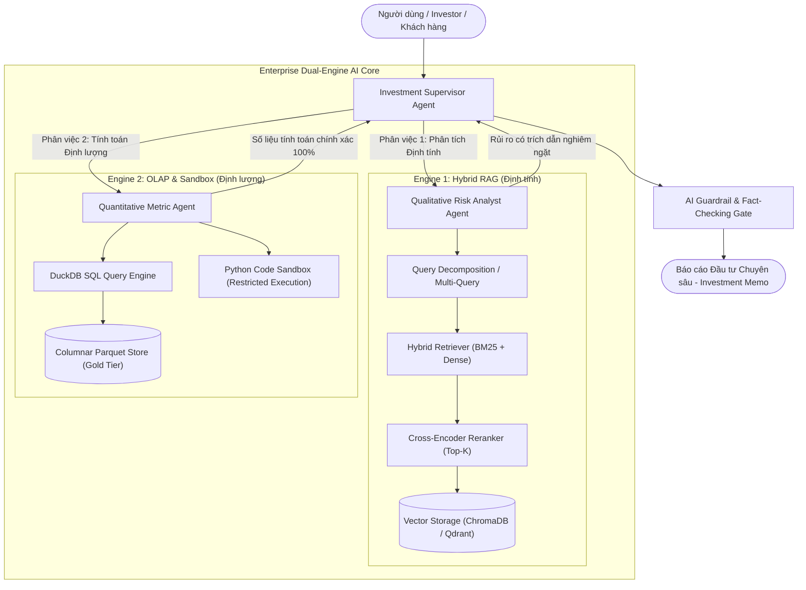

# 🏛️ ENTERPRISE AI ARCHITECTURE & UPGRADE ROADMAP
> **Dự án:** Pluggable Enterprise Financial & Business Intelligence AI Platform  
> **Kiến trúc:** Dual-Engine (Hybrid RAG + Analytical OLAP) & Ports-and-Adapters (Hexagonal Architecture)  
> **Phiên bản:** 2026 Production Standard  
> **Vị trí lưu trữ:** `D:\sec-financial-data-pipeline\ENTERPRISE_AI_BLUEPRINT.md`

---

## 📑 MỤC LỤC
1. [Triết lý Thiết kế: Ghép Lỏng (Loosely Coupled & Pluggable)](#1-triết-lý-thiết-kế-ghép-lỏng-loosely-coupled--pluggable)
2. [Sơ đồ Kiến trúc Tổng thể (Dual-Engine System Architecture)](#2-sơ-đồ-kiến-trúc-tổng-thể-dual-engine-system-architecture)
3. [Phân Luồng Dữ Liệu Tầng Sâu (Data Plumbing & Medallion)](#3-phân-luồng-dữ-liệu-tầng-sâu-data-plumbing--medallion)
4. [Thiết kế Lõi: Hệ thống Multi-Agent Điều Phối (Supervisor - Worker)](#4-thiết-kế-lõi-hệ-thống-multi-agent-điều-phối-supervisor---worker)
5. [Chiến Lược Mở Rộng Quy Mô (Scalability) & Đảm Bảo Thuộc Tính Hệ Thống](#5-chiến-lược-mở-rộng-quy-mô-scalability--đảm-bảo-thuộc-tính-hệ-thống)
6. [Lộ Trình Triển Khai Chi Tiết (Step-by-Step Execution Plan)](#6-lộ-trình-triển-khai-chi-tiết-step-by-step-execution-plan)

---

## 1. TRIẾT LÝ THIẾT KẾ: GHÉP LỎNG (LOOSELY COUPLED & PLUGGABLE)

Để hệ thống không bị "trói chết" vào một nguồn dữ liệu duy nhất (như SEC 10-K), toàn bộ kiến trúc tuân thủ nghiêm ngặt mô hình **Ports & Adapters (Hexagonal Architecture)**:

```text
┌─────────────────────────────────────────────────────────────────────────────────────────┐
│                                 CORE DOMAIN CONTRACTS                                   │
│  - DocumentChunk: [id, entity, period, text, metadata, source_hash]                     │
│  - StructuredFact: [entity, period, metric_name, value, unit, confidence]              │
│  - AgentDecision: [thought, tool_calls, partial_report, status]                          │
└───────────────────────────────────────────┬─────────────────────────────────────────────┘
                                            │
        ┌───────────────────────────────────┼───────────────────────────────────┐
        │                                   │                                   │
        ▼                                   ▼                                   ▼
[INGESTION PORTS]                   [STORAGE PORTS]                     [AGENT ENGINE PORTS]
• Interface: BaseIngestionAdapter   • Interface: BaseVectorStore        • Interface: BaseAgentWorker
  ├─ Sec10KAdapter (Hiện tại)         ├─ ChromaAdapter (Local Dev)        ├─ QualitativeRiskAgent
  ├─ InternalPDFAdapter (Tương lai)   ├─ QdrantAdapter (Cloud Prod)       ├─ QuantitativeMetricAgent
  └─ CsvExcelAdapter (Tương lai)    • Interface: BaseQueryEngine          └─ SynthesisSupervisor
                                      ├─ DuckDBAdapter (In-Process)
                                      └─ PostgresAdapter (Enterprise)
```

> **Nguyên tắc vàng:** Khi thay đổi nguồn dữ liệu từ SEC sang báo cáo tài chính nội bộ, hoặc chuyển từ ChromaDB sang Qdrant/Milvus, **chỉ cần viết thêm 1 Adapter mới** kế thừa Interface. Toàn bộ logic Multi-Agent và RAG phía sau giữ nguyên 100%.

---

## 2. SƠ ĐỒ KIẾN TRÚC TỔNG THỂ (DUAL-ENGINE SYSTEM ARCHITECTURE)

Hệ thống vận hành theo cơ chế **Động cơ kép (Dual-Engine)**:
- **Engine 1 (Unstructured / Hybrid RAG):** Đọc hiểu chữ, ngữ cảnh, các rủi ro chiến lược định tính.
- **Engine 2 (Structured / OLAP DuckDB):** Tính toán số học, tỷ lệ tăng trưởng, định giá với độ chính xác 100% bằng code Python/SQL (Tuyệt đối không để LLM đoán số).



---

## 3. PHÂN LUỒNG DỮ LIỆU TẦNG SÂU (DATA PLUMBING & MEDALLION)

Dữ liệu di chuyển qua 4 tầng Medallion được kiểm soát bởi các **Quality Gates**:

```text
[BRONZE LAYER - Raw Data Lake]
  ├── Lưu trữ nguyên bản: HTML, XBRL JSON, PDF thô.
  ├── Đặc tính: Bất biến (Immutable), làm nguồn đối chiếu kiểm toán (Audit Trail).
  └── Gate 1: Check HTTP Status 200, Check File Size, Check Accession Match.
        │
        ▼
[SILVER LAYER - Cleansed & Extracted]
  ├── Chuẩn hóa: Bóc sạch CSS/DOM rác, tách riêng Bảng biểu và Văn bản tự sự.
  ├── Bảo toàn cấu trúc: Bảng tài chính được chuyển thành Markdown Table có Header.
  └── Gate 2: Schema Validation (Pydantic), Check Missing Mandatory Sections (Item 1A, Item 7).
        │
        ▼
[GOLD LAYER - Analytical Units & Parquet]
  ├── Phân mảnh ngữ nghĩa (Semantic Chunks) kèm Context Headers [ENTITY | YEAR | SECTION].
  ├── Trích xuất bảng số liệu thành Snappy Parquet phục vụ truy vấn OLAP siêu tốc.
  ├── Tạo chỉ mục từ khóa Sparse BM25 Okapi.
  └── Gate 3: Check Token Overlap, Check Vector Dimensions, Check Zero-vector.
        │
        ▼
[CURATED LAYER - Production AI Serving]
  ├── Vector Index: HNSW Embedding Collection.
  ├── DuckDB Catalog: Bảng dữ liệu sẵn sàng cho SQL queries.
  └── Semantic Cache Store: Lưu đệm câu trả lời theo ngữ nghĩa (Giảm 70% chi phí API).
```

---

## 4. THIẾT KẾ LÕI: HỆ THỐNG MULTI-AGENT ĐIỀU PHỐI (SUPERVISOR - WORKER)

### 4.1 Cấu trúc Shared State Bất Biến (`FinancialTeamState`)
```python
from pydantic import BaseModel, Field
from typing import List, Dict, Any, Optional

class FinancialTeamState(BaseModel):
    user_query: str = Field(description="Yêu cầu đầu vào của người dùng")
    target_entities: List[str] = Field(default_factory=list, description="Mã chứng khoán/công ty cần phân tích")
    qualitative_risks: Optional[Dict[str, Any]] = Field(default=None, description="Kết quả phân tích rủi ro từ RAG")
    quantitative_metrics: Optional[Dict[str, Any]] = Field(default=None, description="Kết quả tính toán tài chính từ DuckDB/Python")
    audit_trail: List[str] = Field(default_factory=list, description="Lịch sử các bước suy luận và gọi Tool")
    iteration_count: int = Field(default=0, description="Số vòng lặp hiện tại (Max Recursion Guard)")
    final_memo: Optional[str] = Field(default=None, description="Bản báo cáo đầu tư hoàn chỉnh cuối cùng")
```

### 4.2 Các Agent Thành Viên:
1. **Investment Supervisor Agent (Trưởng nhóm):**
   - Phân rã bài toán, giao việc cho các Worker.
   - Kiểm soát chất lượng: Nếu Worker trả về thiếu bằng chứng trích dẫn $\rightarrow$ bắt làm lại (tối đa 3 vòng lặp).
   - Tổng hợp và cấu trúc hóa bản báo cáo đầu tư cuối cùng (Investment Memo).
2. **Qualitative Risk Analyst Agent (Chuyên gia rủi ro):**
   - Sở hữu Tool: `hybrid_rag_search(query, entity, top_k)`.
   - Phân tích rủi ro theo 4 nhóm: Cạnh tranh AI, Chuỗi cung ứng, Pháp lý chống độc quyền, Địa chính trị.
   - Bắt buộc trích dẫn nguồn: `[Entity | Form | Section | Chunk ID]`.
3. **Quantitative Metric Agent (Chuyên gia định lượng):**
   - Sở hữu Tool: `duckdb_query(sql_statement)` và `python_sandbox_calculator(code)`.
   - Tính toán biên lợi nhuận, ROE, tỷ lệ tăng trưởng YoY, định giá P/E từ bảng số liệu Parquet.
   - Tuyệt đối không để LLM đoán nhẩm số.

---

## 5. CHIẾN LƯỢC MỞ RỘNG QUY MÔ (SCALABILITY) & ĐẢM BẢO THUỘC TÍNH HỆ THỐNG

| Thuộc tính Kiến trúc | Vấn đề khi Scale lớn | Giải pháp Kỹ thuật Đảm bảo |
| :--- | :--- | :--- |
| **Compute / Storage Decoupling** | Đọc ghi đồng thời nghẽn ổ cứng cục bộ khi tăng hàng nghìn file. | Lưu file Parquet trên S3/MinIO; Compute (DuckDB/Embedding) chạy Stateless trên worker nodes. |
| **Idempotency (Tính lũy bao)** | Pipeline sập giữa chừng gây trùng lặp dữ liệu khi chạy lại. | Mỗi tài liệu và chunk gắn ID là `hash(doc_id + chunk_index)`. Tự động bỏ qua nếu ID đã tồn tại. |
| **High Availability & Fault Tolerance** | LLM API chạm trần Rate Limit (HTTP 429) hoặc sập mạng. | Circuit Breaker Pattern: Tự động fallback sang Local LLM (Ollama/vLLM) hoặc OpenAI dự phòng. |
| **Security & Sandbox Isolation** | Mã độc hoặc Prompt Injection qua hàm `eval()` Python. | Chạy code trong Sandbox cô lập (RestrictedPython / Wasm Pyodide / Docker riêng), chặn quyền mạng và chặn đọc `.env`. |
| **Cost & Latency Optimization** | Chi phí API tăng vọt khi nhiều người dùng hỏi câu tương tự. | Semantic Caching: Kiểm tra khoảng cách vector của câu hỏi, nếu tương đồng > 0.95 thì trả cache trong 5ms với chi phí \$0. |

---

## 6. LỘ TRÌNH TRIỂN KHAI CHI TIẾT (STEP-BY-STEP EXECUTION PLAN)

### 🚀 Giai đoạn 1: Chuẩn Hóa Kiến Trúc Ghép Lỏng & Adapter (Pluggable Core)
- [ ] **Bước 1.1:** Tạo thư mục `src/interfaces/`:
  - `base_vector_store.py`: Định nghĩa Interface tìm kiếm Vector.
  - `base_query_engine.py`: Định nghĩa Interface truy vấn dữ liệu có cấu trúc.
  - `base_agent.py`: Định nghĩa Interface cho các Worker.
- [ ] **Bước 1.2:** Viết Adapter cho ChromaDB (`src/adapters/chroma_adapter.py`) và DuckDB (`src/adapters/duckdb_adapter.py`).

### 🚀 Giai đoạn 2: Trích Xuất Dữ Liệu Bảng Biểu & Số Liệu Tài Chính (Dual Data Pipeline)
- [ ] **Bước 2.1:** Bóc tách bảng tài chính (Financial Tables) giữ nguyên Markdown Format.
- [ ] **Bước 2.2:** Xây dựng file `financial_metrics.parquet` chứa các chỉ số tài chính cơ bản của danh sách công ty (AAPL, MSFT, NVDA, GOOGL, META, AMZN, TSLA).

### 🚀 Giai đoạn 3: Nâng Cấp RAG Tầng Sâu (Production Hybrid RAG & Reranker)
- [ ] **Bước 3.1:** Thêm module Query Decomposition (tách câu hỏi so sánh nhiều công ty).
- [ ] **Bước 3.2:** Tích hợp Cross-Encoder Reranker chấm điểm lọc Top-K trước khi nạp context cho Agent.

### 🚀 Giai đoạn 4: Xây Dựng Hệ Thống Multi-Agent Supervisor
- [ ] **Bước 4.1:** Viết `src/agents/state.py` định nghĩa `FinancialTeamState`.
- [ ] **Bước 4.2:** Viết `src/agents/tools.py` tích hợp RAG Tool và DuckDB/Python Sandbox Tool.
- [ ] **Bước 4.3:** Viết `src/agents/workers.py` cài đặt Risk Worker, Metric Worker và Supervisor.

### 🚀 Giai đoạn 5: LLMOps, Tracing, Caching & CLI Showcase
- [ ] **Bước 5.1:** Tích hợp Semantic Caching & Tracing (Langfuse).
- [ ] **Bước 5.2:** Xây dựng CLI Interactive Dashboard bằng `rich` hiển thị tiến trình trao đổi của Agent và xuất bản báo cáo phân tích đầu tư.

---

*Tài liệu này là bản thiết kế kiến trúc chuẩn của dự án. Mọi nâng cấp tiếp theo sẽ bám sát theo các giai đoạn trên.*
